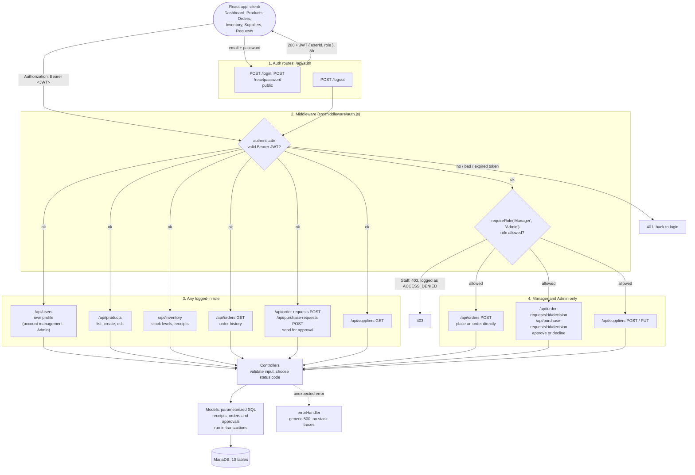
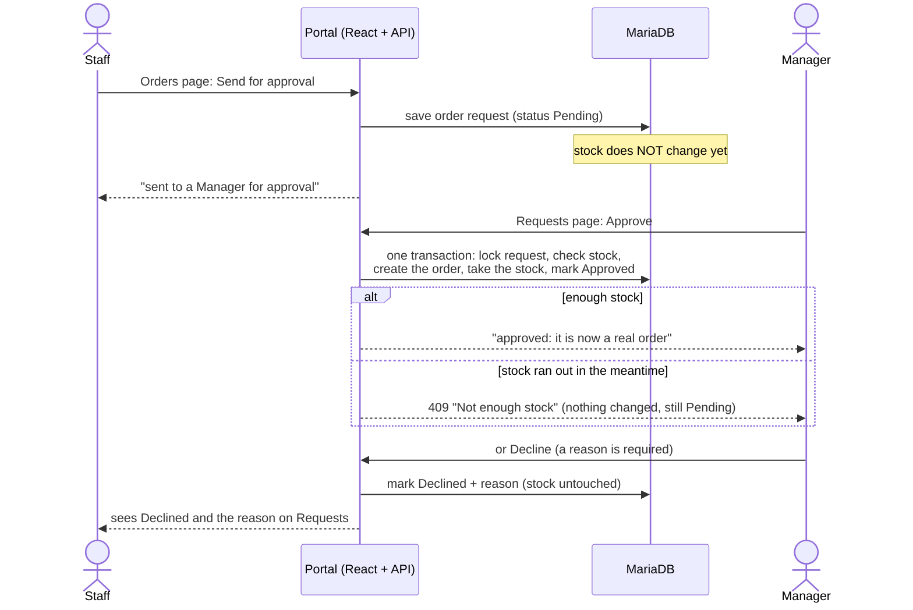
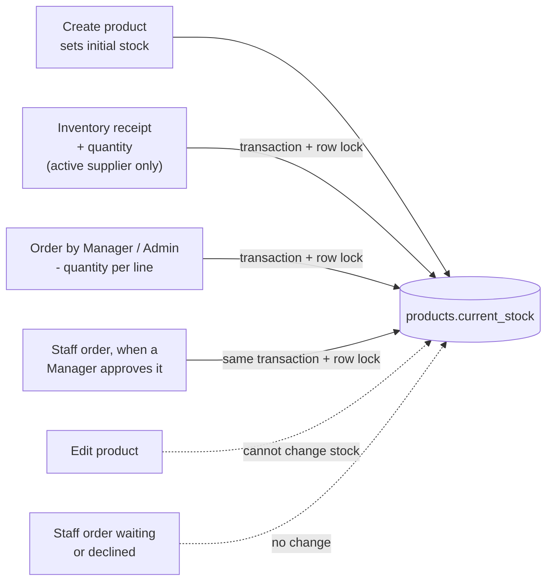
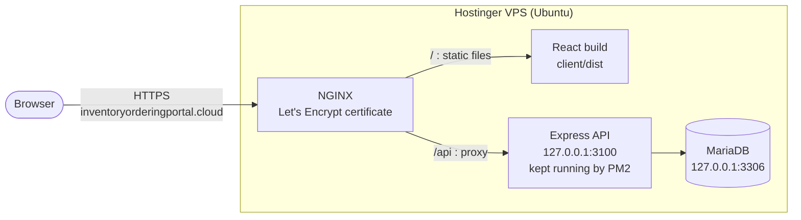
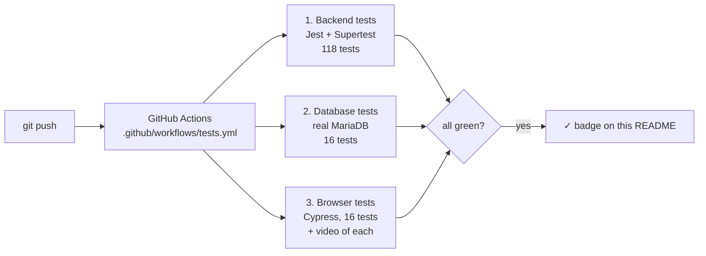

# Inventory Ordering Portal

[](https://github.com/Pedriux0/inventory-ordering-portal/actions/workflows/tests.yml) · [what each test covers](docs/TESTS.md)

Inventory and ordering portal with three roles: Staff, Manager and Admin. The frontend is React (Vite), and the backend uses Express 5, MySQL/MariaDB, bcrypt and JWT.

**Live:** https://inventoryorderingportal.cloud · **Current version: v2.3.0** (Milestone 2, with inventory approval and Manager approval of Staff orders)

## Diagrams

### 1. How a request travels through the app



### 2. Approvals: Staff ask, a Manager decides



Purchase requests (asking for products from a supplier, req 2.2.5) follow the same pattern: Staff requests wait for a Manager, and Managers' and Admins' own requests are approved straight away. Approving a purchase request doesn't change stock; the stock goes up when the delivery is recorded as a receipt.

### 3. How stock changes



Stock only changes in these ways, and each receipt or order keeps a record (`inventory_receipts`, `order_items`), so the current stock can always be traced back.

### 4. Where it runs (live deployment)



The API and the database only listen on `127.0.0.1`, so the internet can reach them only through NGINX over HTTPS. See [deploy/DEPLOY.md](deploy/DEPLOY.md).

### 5. Automated tests on every push (GitHub Actions)



[See the latest runs](https://github.com/Pedriux0/inventory-ordering-portal/actions/workflows/tests.yml) · [what each test covers](docs/TESTS.md)

### What happens to the JWT

1. **Login.** `POST /api/auth/login` checks the bcrypt hash and returns a JWT signed with `JWT_SECRET`. The token holds only `userId` and `role`, and it expires after 8 hours.
2. **In the browser.** The React app keeps the token in `sessionStorage`, so it's cleared when the tab closes. `client/src/api.js` adds it to every request as `Authorization: Bearer <token>`.
3. **Every protected request.** `authenticate` verifies the signature and expiry, then sets `req.user`. `requireRole` reads the role from the token, never from the request body.
4. **Expired token.** Any 401 response sends the user back to the login page.
5. **Logout.** The server returns 200 and writes an audit entry. The client then deletes the token.

## Design decisions

### Milestone 1: auth, roles and profile

| Decision | Why |
|---|---|
| **Layers: route → middleware → controller → model** | Each layer does one job. Models hold all the SQL, so the tests can replace them with fakes and run without a database. |
| **JWT sessions with no server-side session store** | A request can be verified using only the secret. The token contains `userId` and `role` and nothing sensitive. |
| **Logout doesn't revoke the token on the server** | Revoking a JWT needs a blacklist table, and the ERD doesn't have one. Logout logs the event (req 2.1.4). The 8h expiry limits how long a leaked token stays usable. |
| **Two middlewares: `authenticate` and `requireRole`** | Two questions: "who are you?" (401) and "are you allowed to do this?" (403). Both access denials and failed logins are logged (reqs 3.2.2, 3.2.3). |
| **bcrypt, 16+ character passwords** | bcrypt is slow on purpose and salts each hash (reqs 2.1.2, 2.1.3). |
| **Same error for an unknown email and a wrong password** | Login and password reset can't be used to find out which emails have accounts. |
| **Reset tokens stored as SHA-256 hashes** | A database leak can't be used to reset accounts (req 2.1.5; the token isn't emailed yet). |
| **Parameterized SQL and one central `errorHandler`** | Every query protects against SQL injection (req 3.1.1), and users never see internal errors (reqs 3.2.1, 3.2.4). |

### Milestone 2: products, inventory, orders and suppliers

| Decision | Why |
|---|---|
| **Stock only changes through receipts and orders** | Editing a product can't change its stock. That keeps `current_stock` consistent with the receipt and order history. |
| **Receipts and orders run in one transaction with `SELECT ... FOR UPDATE`** | Every part of an order is saved, or nothing is. If two people sell the last units at the same moment, the second one waits and is then refused. This is tested against a real database (req 3.4.1). |
| **Stock math in plain functions (`src/utils/stock.js`)** | UT-03 and UT-04 test the exact functions the models use, without needing a database. |
| **The price is copied into `order_items.unit_price_at_sale`** | Changing a product's price later doesn't change past orders. Totals are calculated in cents to avoid rounding errors. |
| **Suppliers: Staff can view, Manager and Admin can change** | Reqs 2.2.5 and 2.5.6 name Manager, and Admin is included because it has full access to the system. Staff need to read the list to record receipts. |
| **Suppliers are deactivated, never deleted** | Receipts point to suppliers with a foreign key, so deleting one would break the history. Deactivated suppliers can't receive new stock. |
| **Who did it comes from the token** | `received_by` and `orders.user_id` come from `req.user`, so a user can't record actions under someone else's name. |
| **Products, receipts and orders open to every role** | Reqs 2.5.1–2.5.4 give these to Staff, and Manager and Admin can do everything Staff can. |
| **The UI hides buttons, but the API enforces the rules** | Staff don't see "New supplier", and the API also returns 403 if they call it directly. |
| **No "category" field** | Mockup 3 shows one, but the ERD and requirement 2.4.1 don't, so the ERD wins. |

### Approvals (v2.2.0 and v2.3.0, defined with the client)

| Decision | Why |
|---|---|
| **Staff sales orders wait for a Manager** (client change to req 2.5.3) | The client wants every Staff sale checked. `POST /api/orders` is Manager/Admin only, so the rule is enforced by the API, not just hidden in the UI. |
| **Stock goes down on approval, not when the request is sent** | The sale only really happens when it's approved. If stock ran out in between, the approval is refused and nothing changes. |
| **Separate `order_requests` tables** | The `orders` table only ever holds real, approved sales, so the order history and its totals stay correct. Approval reuses the same, already-tested order code (`insertOrder`). |
| **Approval in one transaction with a row lock** | Two Managers clicking Approve at the same moment create only one order (tested on a real database). |
| **Declining needs a reason** | The Staff member sees why, for example "order 50, not 500". |
| **Managers' and Admins' own requests need no approval** | They're the approvers. Their purchase requests are saved as Approved straight away. |
| **Every decision is in the audit log** | `ORDER_APPROVED`, `ORDER_DECLINED`, `REQUEST_APPROVED` and `REQUEST_DECLINED`, with who did it. |

## Running it locally

```bash
# backend
npm install
cp .env.example .env              # fill in DB credentials and JWT_SECRET
mysql -u root -p < db/schema.sql  # creates the database and 10 tables
npm run seed                      # demo users, suppliers and products (local only)
npm run dev                       # API on http://localhost:3000

# frontend (second terminal)
cd client
npm install
npm run dev                       # http://localhost:5173, /api is forwarded to :3000
```

Demo logins (created by `npm run seed`):

| Role | Email | Password |
|---|---|---|
| Admin | admin@demo.com | DemoAdminPass2026 |
| Manager | manager@demo.com | DemoManagerPass2026 |
| Staff | staff@demo.com | DemoStaffPass2026 |

## Tests

| Command | What it runs |
|---|---|
| `npm test` | 118 unit and API tests (Jest + Supertest), with the models mocked so no database is needed |
| `npm run test:db` | 16 real-database tests: UT-09, stock after a receipt or order, rollback, simultaneous orders and approvals |
| `cd client && npm run test:e2e` | 16 Cypress browser tests (FE-01–05, FE-10, FE-11, FE-16, FE-17 and more). The app must be running and seeded |

All three also run automatically on GitHub on every push (see diagram 5). [docs/TESTS.md](docs/TESTS.md) maps every test ID from the proposal to its test.

If Cypress fails to start from a VS Code terminal with `bad option: --ping`, run it as `env -u ELECTRON_RUN_AS_NODE npm run test:e2e`.

## Deploying

Live at **https://inventoryorderingportal.cloud** (see diagram 4). [deploy/DEPLOY.md](deploy/DEPLOY.md) has the full Hostinger VPS setup: NGINX serves the React build and forwards `/api` to Express, which runs under PM2. New tables come with migration files in `db/migrations/`.

## Status

- **Milestone 1 (v1.0.0):** login, logout, password-reset request, role-based access, profile and admin account management (API only).
- **Milestone 2 (v2.0.0 → v2.3.0):** Staff sales orders need Manager approval (client change to 2.5.3, v2.3.0), purchase requests with Manager approval (2.2.5, v2.2.0), products (2.4.1, 2.5.1), inventory receipts and stock (2.4.2, 2.5.2, 2.5.4), sales orders (2.4.3, 2.5.3), suppliers (2.2.5, 2.4.4, 2.5.6), the React frontend for all of these, and the deploy configuration.
- **Not built yet:** search, sort and pagination (Week 7), the reset-token "set new password" endpoint, and the profile and user-admin screens (the API for them exists).

Requirement-by-requirement walkthroughs: [MILESTONE_1_OVERVIEW.md](MILESTONE_1_OVERVIEW.md) and [MILESTONE_2_OVERVIEW.md](MILESTONE_2_OVERVIEW.md).
